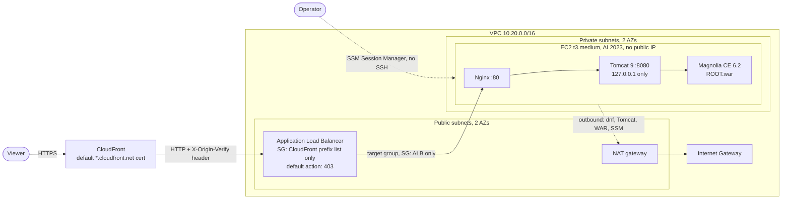
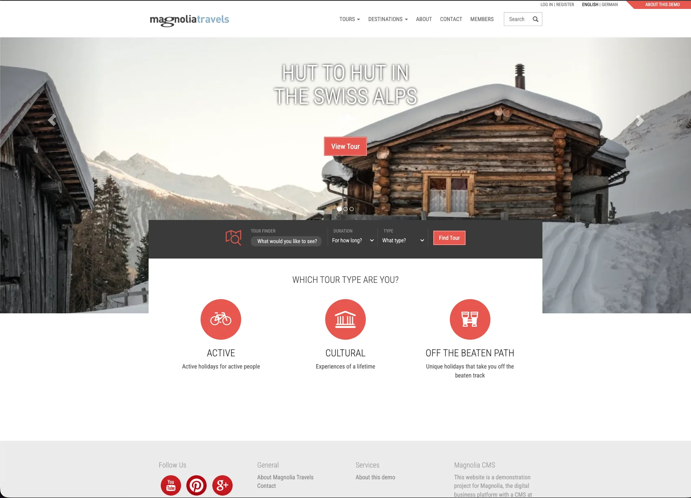

# Crescendo DevOps exam: Magnolia CMS on AWS with Terraform

Terraform that deploys **Magnolia CMS Community Edition** on AWS behind an **ALB** and **CloudFront**: Nginx reverse-proxies to Tomcat 9 on a single EC2 instance in a private subnet. A GitHub Actions workflow runs `fmt`, `validate` and `plan` on every pull request.

> **How this was validated.** No real AWS account was used (agreed with the reviewer). The code is validated in three layers: static checks, a full `plan` and a partial `apply` against the [Floci](https://floci.io) AWS emulator, and two Docker tests of the application layer (a smoke test, and the real `user_data` script run on Amazon Linux 2023). The real-AWS request path is explained below, together with exactly what the local tests do *not* prove. See [ADR 0002](docs/adr/0002-scope-and-validation-strategy.md).

## Architecture



**Request path in real AWS**

1. The browser connects to CloudFront over HTTPS (the default `*.cloudfront.net` certificate); HTTP is redirected to HTTPS.
2. CloudFront forwards to the ALB over HTTP and adds a secret `X-Origin-Verify` header. Static paths (`/.resources/*`, `/dam/*`, `/docroot/*`) are cached; everything else is passed through uncached.
3. The ALB security group only accepts CloudFront's managed prefix list. The listener answers **403** unless the secret header is present, then forwards to the target group.
4. The instance only accepts port 80 from the ALB security group. Nginx proxies to Tomcat on `127.0.0.1:8080`, passing `X-Forwarded-Proto` from CloudFront's `CloudFront-Forwarded-Proto`, so Magnolia builds correct HTTPS URLs.
5. Operators reach the instance through SSM Session Manager (no SSH key, no open port 22).

## Repository layout

```
.
├── infra/
│   ├── main.tf variables.tf outputs.tf providers.tf versions.tf   # root module: wires the four modules
│   ├── modules/
│   │   ├── network/      # VPC, 2 public + 2 private subnets, IGW, NAT, route tables
│   │   ├── alb/          # ALB, target group, listener rule with the origin secret, security group
│   │   ├── compute/      # EC2, IAM (SSM), security group, provisioning (templates/ + files/)
│   │   └── cloudfront/   # distribution, cache behaviors
│   ├── examples/floci/   # settings and script to apply the stack to the Floci emulator
│   ├── backend.tf.example terraform.tfvars.example
│   └── .tflint.hcl
├── docker/
│   ├── smoke/        # Nginx -> Tomcat -> Magnolia smoke test using the same config files
│   └── al2023/       # runs the real user_data script on Amazon Linux 2023 (systemctl stubbed)
├── .github/workflows/terraform.yml
├── Makefile          # local entry points: fmt-check, validate, lint, smoke, al2023, floci-*
└── docs/
    ├── adr/          # architecture decision records (the "why")
    ├── validation-log.md   # what the local tests found and changed
    └── evidence/     # raw test output and the screenshot
```

## How to run it

### Prerequisites
- Terraform >= 1.10, Docker (for the local tests), [tflint](https://github.com/terraform-linters/tflint) (optional)
- For a real deployment: an AWS account and credentials with rights to create the resources above (VPC, EC2, ELB, CloudFront, IAM roles/instance profiles)

### Local validation (no AWS account needed)
```bash
make fmt-check validate lint   # static checks
make smoke                     # builds the image and tests Nginx -> Tomcat -> Magnolia; evidence in docs/evidence/
                               # variants: INSTANCE_TYPE=author make smoke, JAVA_VERSION=17 make smoke
make al2023                    # runs the real user_data script on Amazon Linux 2023 in Docker, then checks the result
make floci-apply               # applies the emulator-supported part of the stack to Floci (FULL=1 for everything)
make floci-destroy floci-down  # clean up
```
`make smoke` leaves the container running only while the test runs; run `docker run --rm -p 8081:80 magnolia-smoke:java11-public` afterwards to browse Magnolia at http://localhost:8081.

### Deploy to real AWS
```bash
cd infra
cp terraform.tfvars.example terraform.tfvars    # adjust region/project if needed
export AWS_PROFILE=<your-profile>               # or any other standard credential source
terraform init
terraform plan
terraform apply                                  # CloudFront takes ~5-15 min; Magnolia first boot a few more
terraform output cloudfront_url
```
First boot installs the packages and bootstraps Magnolia's repository, so the site can take a few minutes to become healthy after `apply` returns. Follow progress with the `ssm_session_command` output, then `tail -f /var/log/provision.log`.

Tear down when finished: `terraform destroy`. NAT gateway and ALB bill hourly (roughly $3-4/day for the whole stack).

### Required secrets and variables (CI)
| Name | Where | Needed for |
|---|---|---|
| none | | `fmt`, `validate`, tflint and the Floci plan run without any secret |
| `AWS_ROLE_ARN` (repository variable) | GitHub | optional real-AWS `plan` job via OIDC; skipped when unset or on fork PRs |
| `AWS_REGION` (repository variable) | GitHub | optional, defaults to `eu-west-1` |

The role must trust GitHub's OIDC provider for this repository and be read-only (plan only).

### Useful variables
`single_nat_gateway` (default `true`), `instance_type` (`t3.medium`), `magnolia_instance_type` (`public`), `expose_admin` (`false`), `tomcat_version`, `magnolia_war_url`, `jvm_heap_mb`. All have validation; see `variables.tf`.

## What the local validation proves (and what it does not)

| Layer | Proves | Does not prove |
|---|---|---|
| `fmt`, `validate`, tflint | Syntax, types, references, module interfaces | Anything about runtime behavior |
| Floci plan + apply | A full `plan` of every resource and reference; an `apply` of about 32 resources (network, IAM, security groups and rules, ALB, listener with the origin-secret rule) with the real AWS provider | The EC2 instance, target-group attachment and CloudFront distribution cannot complete in the emulator (see [validation log](docs/validation-log.md)); security-group enforcement, real routing, NAT, ALB-to-instance traffic, CloudFront delivery |
| Docker smoke test | Tomcat 9 + Magnolia CE start, Nginx proxies correctly, `X-Forwarded-Proto` handling, admin blocked, data written under `/var/lib/magnolia` | Anything specific to Amazon Linux 2023 (see the next row) |
| AL2023 provisioning test (`make al2023`) | The real `user_data` script, rendered from the template, runs on Amazon Linux 2023: `dnf` package names, Tomcat download and checksum, users and permissions, Nginx config, the systemd unit (a `systemctl` stub reads the real unit file and starts Tomcat from it), the health check through Nginx, and a second run of the script (idempotency) | A real boot with systemd and cloud-init, the unit's sandboxing options (`PrivateTmp`, `ProtectSystem`), instance metadata, IAM/SSM, VPC networking |

Evidence from the latest runs is stored in `docs/evidence/`; the story of what failed and why is in [docs/validation-log.md](docs/validation-log.md). Latest smoke test (Java 11, public instance): Magnolia answered `/.rest/status` with 200 about 20 s after container start; `/` redirects to `/travel.html`; `/travel/` returns 200 ("Travel Home"); `/.magnolia/` is blocked with 403; redirects stay relative when `CloudFront-Forwarded-Proto: https` is sent; the repository is written under `/var/lib/magnolia`. Latest `make al2023` run (Amazon Linux 2023, Corretto 11, Nginx 1.30, Tomcat 9.0.98): the unmodified `user_data` script completed in about 2 minutes, all checks passed, and a second run was a no-op. That test also found two real provisioning bugs (Tomcat directory and script permissions) that the Debian smoke test could not see; see the [validation log](docs/validation-log.md).



*Magnolia CE public instance running in the smoke-test container, reached through Nginx on `localhost:8081`.*

## Assumptions
- A single environment in one region; `eu-west-1` by default.
- No custom domain, so viewers use the `*.cloudfront.net` name and the default certificate.
- Magnolia CE demo bundle 6.2 on Tomcat 9 and Corretto 11, as verified by `make smoke` ([ADR 0005](docs/adr/0005-application-stack-and-provisioning.md)); the versions are variables. A **public** Magnolia instance serves visitors; editing needs a separate author instance ([ADR 0011](docs/adr/0011-public-instance-and-health-check.md)).
- The AWS account has default quotas. The CloudFront prefix list uses about 55 of the 60 default rules of the ALB security group.

## Known limitations
- **CloudFront to ALB is plain HTTP** (no domain, so no ACM certificate). The origin secret header therefore crosses AWS's network unencrypted. With a domain: ACM certificate on the ALB and an HTTPS-only origin policy.
- **Single instance, local disk.** The Magnolia repository lives on the instance volume: one instance is a single point of failure, and replacing it loses content.
- **Single NAT gateway** by default (cost); one per AZ with `single_nat_gateway = false`.
- **`user_data` provisioning** depends on `archive.apache.org` and Magnolia's Nexus being reachable at boot. Checksums are verified (SHA-512 for Tomcat, SHA-1 for the WAR, which only protects against corruption).
- **Admin UI blocked by default** ([ADR 0010](docs/adr/0010-admin-interface-exposure.md)). Reach it with the `ssm_port_forward_command` output, or set `expose_admin = true` and change the default `superuser` password immediately.
- **State is local by default.** `infra/backend.tf.example` shows the S3 backend. State contains the origin secret and must not be shared or committed.
- `infra/.terraform.lock.hcl` pins the provider versions and is committed; update it with `terraform init -upgrade`.

## How I would keep moving forward on a real project
1. **Baked AMI with Packer** and an **Auto Scaling group** across both private subnets (the second one is already there), so instances are disposable.
2. **RDS PostgreSQL** (or shared storage) for the Magnolia repository; separate **author** and **public** tiers, with the admin behind SSO or a VPN.
3. **Domain + ACM + Route 53**, HTTPS end to end, then **WAF** on CloudFront.
4. **Remote state** (S3 with native locking), per-environment configuration, **apply on merge** with environment approvals, Infracost and Checkov in CI.
5. **Observability**: Datadog agent and APM, ALB/CloudFront access logs, alarms on target health and 5xx, SLOs and runbooks.
6. **Backups** (AWS Backup) and a tested restore procedure.
7. **Cache tuning** per content type once real traffic data exists ([ADR 0007](docs/adr/0007-cloudfront-caching-and-headers.md)).

## Decisions
All significant decisions are recorded in [docs/adr](docs/adr/README.md).
